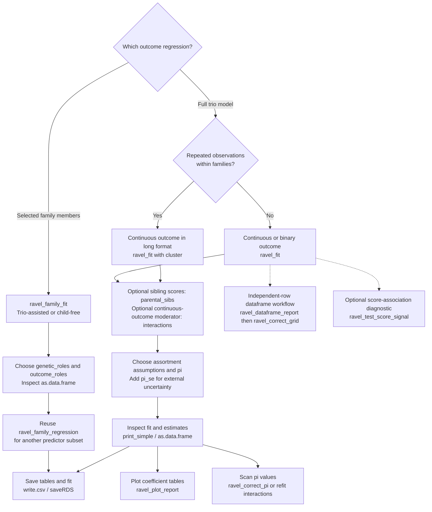
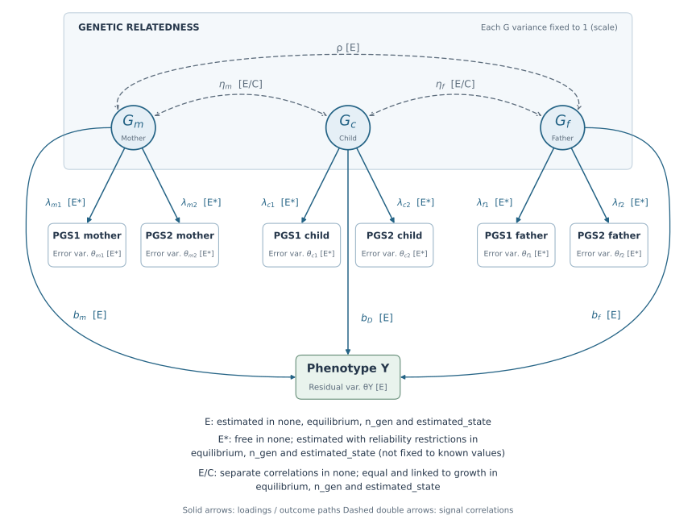

# RAVEL

**Recovering Assortment-Adjusted Variance Explained by Genetic Liabilities**

RAVEL estimates genetic-liability associations with outcomes in children or
adults, using two independently constructed polygenic scores (PGSs) per person.
Fit trios, full-sibling pairs, or partners with either or both partners' siblings.
RAVEL accounts for PGS measurement error and can correct for assortative mating
and hidden genetic variation.

**Author:** Daniel Malawsky (<d.malawsky@gmail.com>), Wellcome Sanger Institute

## Install

```r
remotes::install_github("malawsky/RAVEL", ref = "dev")
library(RAVEL)
```

Requires R >= 4.0, lavaan >= 0.6-12 and MASS. To install a local checkout,
run `devtools::install()` from its directory, or use
`devtools::load_all(".")` while developing.

Use `ref = "dev"` to install the family-regression functions and other APIs
documented below; the default branch may contain an older release.

## Quick start

Try the bundled simulated data, or replace `dat` with your own trio data:

```r
data("ravel_example", package = "RAVEL")
dat <- ravel_example
names(dat) <- sub("^pgs", "PGS", names(dat))
dat$Y <- as.numeric(scale(dat$Y))  # omit to keep the outcome's original units

fit <- ravel_fit(dat, pi = .40, pi_se = .05,
                 fit_constraints = "estimated_state")
print_simple(fit)
results <- as.data.frame(fit)
```

For coefficient rows, the `scale` column means:

- `visible`: effect per 1 SD of that person's score-indexed genetic liability,
  with PGS measurement error accounted for.
- `corrected_std`: effect per 1 present-day SD of that person's total genetic
  liability, including the assumed hidden component.
- `corrected_raw`: effect per 1 founder/random-mating SD of total genetic
  liability; add `include_raw = TRUE` to include these rows.
- `vanilla`: ordinary regression using one PGS version at a time across the
  included relatives, without measurement-error or pi correction. Each role's
  PGS and continuous `Y` are standardized for this comparator.

The SEM scale labels describe the **genetic predictor**, not the outcome.
Direct fits keep continuous `Y` in its supplied units; the example standardizes
it so SEM and vanilla slopes both use phenotype-SD units. Binary fits use a
probit-liability outcome scale.

This estimates the assortment variance state without specifying a generation
count. It returns visible and total corrected effects, with uncertainty in pi
included in the corrected SEs. No second correction call is needed.

`pi` is the fraction of **founder/random-mating genetic variance hidden from
the scores**, in `[0, 1)`. It is not PGS measurement error or outcome
heritability. Supply its external standard error as `pi_se`, or omit `pi_se`
to treat pi as fixed. The values above are examples; choose them for your trait.
The bundled data have founder pi 0.4, one generation of assortment and founder
PGS reliabilities 0.5 and 0.3. See `?ravel_example`.

For an adult outcome or a model without children, use the
[family-regression examples](#adult-outcomes-and-selected-family-regressions).

## Which workflow fits your data?



The dataframe workflow and its grid do not accept interactions or clustered
observations; use `ravel_fit()` for those. The score-association diagnostic is
restricted to complete, independent continuous-outcome data without covariates
and requires an identified score model. See the examples below.

## Prepare your data

Use two PGS versions targeting the same trait, with independent GWAS estimation
errors. Apply each version's weights to every included family member and orient
both scores toward the same genetic target.

| Person | Default score columns |
|---|---|
| Child | `PGS1_child`, `PGS2_child` |
| Mother | `PGS1_mother`, `PGS2_mother` |
| Father | `PGS1_father`, `PGS2_father` |
| Mother's full sibling, if included | `PGS1_mat_sib`, `PGS2_mat_sib` |
| Father's full sibling, if included | `PGS1_pat_sib`, `PGS2_pat_sib` |

The outcome defaults to `Y`. Map other names with `col_outcome`,
`col_pgs1_child`, `col_pgs2_child` and the corresponding parent arguments.
Supply scores only for the members in your genetic model; reliability is
estimated separately for the two PGS versions.

`ravel_fit()` accepts raw or separately standardized PGS columns: with the default
residual settings or any constrained mode, you do not need to scale parents
against the child, but continuous `Y` stays in its input units unless you
standardize it yourself. `ravel_dataframe_report()` applies each PGS version's
child mean and SD to all included roles and automatically standardizes the
prepared continuous outcome.

Custom covariance-scale restrictions, such as `crossperson = "equal_pc"` or
nonzero `fixed_crossperson` values, depend on the PGS units; keep the input
scaling consistent with those restrictions.

For repeated measurements, use one row per child-occasion, repeat the family
scores, and supply a family identifier through `cluster`. Otherwise, use one
independent trio per row.
For a cross-sectional adult outcome, use one row per focal adult; repeating the
same parent once per child changes their weight even with clustered SEs.

## Choose the assortment assumptions

All modes estimate **separate, unknown reliabilities for PGS1 and PGS2** and
assume independent errors between the two score versions. The constrained
modes add the following restrictions to the base trio model:

| `fit_constraints` | Visible genetic variance growth (child / parent) | Reliability within each PGS | Latent child–parent correlations |
|---|---|---|---|
| `"estimated_state"` | Estimated from the data; no generation count | Equal in mother and father; child follows estimated growth | Equal for both parents; linked to growth and fitted spouse correlation |
| `"equilibrium"` | Fixed to **1** | Equal in mother, father and child | Both fixed to **(1 + fitted spouse correlation) / 2** |
| `"n_gen"` | Determined by fitted assortment, supplied pi and `am_n_generations` | Equal in mother and father; child follows modeled growth | Equal for both parents; linked to growth and fitted spouse correlation |
| `"none"` | No growth restriction in the SEM | Free across family roles | Estimated separately for mother and father |

The three constrained modes also fix **within-score error correlations** to
**0 between spouses** and **0.5 between child and parent**; these are estimated
by default with `"none"`. Spouse signal correlation and outcome coefficients
remain estimated in every mode. `"n_gen"` assumes constant-strength assortment
from random-mating founders; `"estimated_state"` retains the founder and
Mendelian segregation assumptions without specifying a duration. Greater
precision depends on these restrictions being appropriate for your data.

<details>
<summary>View the trio model and parameter labels</summary>



The labels refer to these `fit_constraints` settings:

| Label | `"none"` | `"equilibrium"`, `"n_gen"` and `"estimated_state"` |
|---|---|---|
| **E** | Estimated | Estimated |
| **E\*** (score loadings and error variances) | Freely estimated for each score and family role | Jointly estimated subject to the mode's reliability restrictions in the table above; not fixed to known values |
| **E/C** (child–parent signal correlations) | Mother and father correlations estimated separately | Equal to one another and linked to fitted spouse correlation and variance growth |

Thus **E and E\* are estimated in all four modes**. The asterisk indicates
additional reliability restrictions in `"equilibrium"`, `"n_gen"` and
`"estimated_state"`; it does not mean the loadings or error variances are known.
The diagram uses the default freely estimated parental outcome paths.
The genetic relatedness block contains signal correlations, not score-error
correlations. Each latent G has variance 1 for scale identification; biological
variance growth can still differ from 1.

For the three constrained modes, `eta_m = eta_f = (1 + rho) / (2 * sqrt(B))`,
where B is the child/parent visible-variance ratio from the table above.
For each score separately,
`R_child = B * R_parent / (1 - R_parent + B * R_parent)`;
PGS1 and PGS2 need not have equal reliability or loadings.

Score-error correlations are omitted to keep the paths readable: cross-version
errors have correlation **0** in every mode; within-version spouse and
child–parent error correlations are fixed to **0** and **0.5** in constrained
modes, and estimated by default with `"none"`. Errors are orthogonal to the
signal and outcome. Pi is external to this diagram: it supplies total-effect
correction and also enters `"n_gen"` fitting after the first generation.
This base continuous-outcome model omits optional covariates, parental siblings
and interactions; see their sections below and the [methods](docs/methods.md).

</details>

```r
fit_eq <- ravel_fit(dat, pi = .4, fit_constraints = "equilibrium")
fit_g3 <- ravel_fit(dat, pi = .4, fit_constraints = "n_gen",
                    am_n_generations = 3L)
fit_free <- ravel_fit(dat, pi = .4, fit_constraints = "none",
                      am_correction = "equilibrium")
```

**Bare `ravel_fit(dat)` defaults to** pi 0, unconstrained fitting, a one-generation
post-fit correction and no bootstrap. A constrained mode selects its matching
correction automatically. One generation means random-mating founder parents
and their children after the first assortment round. The older name `h` is
still accepted for pi. [Theory and identification limits](docs/methods.md).

## Read, plot and save results

```r
print_simple(fit)                       # compact results
print_ravel_results(fit)                # diagnostics and detailed results
results <- as.data.frame(fit, include_raw = TRUE, include_vanilla = FALSE)
print(ravel_plot_report(results, scale = "corrected_std"))
write.csv(results, "ravel_results.csv", row.names = FALSE)
saveRDS(fit, "ravel_fit.rds")             # retain covariance and other metadata
```

Visible effects describe the genetic component measured by the scores.
Corrected effects include the assumed hidden component. `corrected_std` uses
current genetic SDs; `corrected_raw` uses the founder reference scale. Parent
coefficients are associations; causal interpretation needs additional assumptions.
Check convergence, warnings and diagnostics before interpreting intervals.

For the parental midpoint and mother–father difference, add
`parent_contrasts = TRUE` to either printer or `as.data.frame()`. These use the
joint coefficient covariance. They compare the parental coefficients; they are
not the within-lineage contrasts from parental siblings. The same option includes
midpoint and mother–father contrasts for each vanilla PGS regression (and in
`ravel_dataframe_report(..., parent_contrasts = TRUE)`). When parental siblings
are requested, vanilla regressions include their scores and automatically return
`delta_M` / `delta_F` (parent minus sibling). Their complete-case sample sizes
are reported separately; missing sibling scores are not imputed.

The default SEs come from the SEM. `pi_se` adds external uncertainty by the delta
method, assuming independent external estimation of pi. For a bootstrap, add
`n_boot = 500, seed = 123` to `ravel_fit()`. Repeated rows must use `cluster` so
whole families are resampled. With `pi_se`, corrected bootstrap intervals use
bootstrap covariance plus pi variance; visible intervals are percentile-based.
[Uncertainty details](docs/reference.md).

## Scan values of pi

For the main effects from unconstrained, equilibrium or estimated-state fits,
recalculate without changing the original fit:

```r
alternative <- ravel_correct_pi(fit, pi = .45, pi_se = .05)
print_simple(alternative)

pi_scan <- do.call(rbind, lapply(c(.3, .4, .5), function(p) {
  ans <- ravel_correct_pi(fit, pi = p, pi_se = .05)
  ans$scenario_pi <- p
  ans
}))
subset(pi_scan, scale == "corrected_std" & parameter == "beta_D",
       select = c(scenario_pi, estimate, se, ci_low, ci_high))
```

Each interval is conditional on its scenario, not a simultaneous band. Retain
the original fit for further inference. Constrained `"n_gen"` fits after
generation one depend on pi and must be refitted at each value. To scan
**interaction effects**, also refit with `ravel_fit(..., pi = p)`:
`ravel_correct_pi()` returns main effects only.

For a dataframe report, use the grid helper shown below instead.

## Covariates and binary outcomes

```r
fit_adjusted <- ravel_fit(dat, pi = .4, pi_se = .05,
  fit_constraints = "estimated_state", fixed_effects = c("age", "PC1", "PC2"))
```

Use numeric `fixed_effects` for joint adjustment; the dataframe workflow handles
categorical covariates. Do not residualize only the outcome when it correlates
with the genetic predictors. Corrected estimates additionally assume the
visible-to-total mapping remains valid after adjustment. Covariates independent
of family genetic components satisfy this; genetically related covariates need
justification. RAVEL cannot establish that assumption from the data.

For a binary `Y` coded 0/1, add `outcome = "binary_liability"`. Effects use the
SEM probit-liability scale. Interactions and `cluster` currently require a
continuous outcome. [Covariate and binary-outcome details](docs/methods.md#covariate-adjustment-and-binary-outcomes).

## Optional: parental siblings

Add two scores for a full sibling of the mother and/or father, using the same
weights as the trio: `PGS1_mat_sib`, `PGS2_mat_sib` and/or `PGS1_pat_sib`,
`PGS2_pat_sib`.

```r
fit_sibs <- ravel_fit(sib_dat, parental_sibs = "both", # or "maternal" / "paternal"
  pi = .4, pi_se = .05, fit_constraints = "estimated_state")
print_simple(fit_sibs)
subset(as.data.frame(fit_sibs), parameter %in% c("delta_M", "delta_F"))
```

The delta rows subtract a parent's sibling coefficient from that parent's
coefficient. A parent-specific causal interpretation additionally requires no
sibling effect on the child and no remaining parent-specific confounding.
Tables, plots, bootstrap and pi uncertainty include sibling effects and
contrasts. [Sibling assumptions and missing-data handling](docs/methods.md#parental-siblings).

## Adult outcomes and selected family regressions

Use `ravel_family_fit()` for adult outcomes or selected-relative regressions:

- `genetic_roles`: whose two scores help identify the joint genetic model.
- `outcome_roles`: whose liabilities enter the reported regression; defaults to
  all `genetic_roles`.

For your own `family_dat` containing the five sets of scores above and maternal
height, keep the child for identification while regressing height on the four
adults' liabilities:

```r
fit_adults <- ravel_family_fit(family_dat,
  genetic_roles = c("child", "mother", "father", "mat_sib", "pat_sib"),
  outcome_roles = c("mother", "mat_sib", "father", "pat_sib"),
  col_outcome = "mom_height", pi = .4, fit_constraints = "estimated_state")
adult_results <- as.data.frame(fit_adults)

# A different regression using the same fitted genetic model:
pair_results <- as.data.frame(
  ravel_family_regression(fit_adults, c("mother", "mat_sib")))
```

The child needs no phenotype and is not an outcome predictor unless selected.
Changing `outcome_roles` gives the requested reduced regression; it does not
just hide rows from the full model. Family tables use `visible`, `total_std`
and `total_raw` for the predictor scales defined above, retain the supplied
outcome units, and include the available parent-minus-sibling contrasts.

With a full-sibling pair only, no child or partner columns are required:

```r
fit_pair <- ravel_family_fit(sib_dat,
  genetic_roles = c("mother", "mat_sib"),
  col_outcome = "mom_height", pi = .4, fit_constraints = "estimated_state")
as.data.frame(fit_pair)
```

Here `mother` is the focal adult and `mat_sib` their full sibling. For partners
with one sibling, use `c("mother", "father", "mat_sib")` or
`c("mother", "father", "pat_sib")`; include all four adult roles for both
siblings. The pedigree roles describe the genetic relationships, not who must
have the outcome. Partners alone need a history assumption or a supplied
`parent_visible_variance` for an estimated-state fit.

Use the family tables above for selected regressions; legacy trio helpers such
as `print_simple()` describe the full source model. Existing `ravel_fit()` calls
retain their previous meaning and output. The
[analysis companion](analysis/parental_deviation/README.md) includes a runnable
synthetic example and runs all eight maternal regressions and pi grids.
For the original editable-settings workflow with parental phenotypes, use
[`ravel_parental_phenotypes.R`](analysis/parental_deviation/ravel_parental_phenotypes.R):
it retains the child for identification and runs every adult predictor subset
containing the focal parent,
with plain-PGS comparisons and saved one-factor diagnostics.
Separate tables expose SEM fit statistics, all parameters and covariance
estimates with SEs, while keeping the primary regression table unchanged.
[Identification, covariate assumptions and uncertainty](docs/family-models.md).

## Optional: interactions and growth

For a continuous outcome, `interactions` estimates how genetic coefficients
change with a numeric covariate. For repeated outcomes, cluster by family:

```r
fit_growth <- ravel_fit(long_dat, pi = .4, pi_se = .05,
  fit_constraints = "estimated_state", interactions = "age",
  interaction_center = c(age = 10), cluster = "FID")
print_simple(fit_growth)
growth_results <- as.data.frame(fit_growth, include_vanilla = FALSE)
print(ravel_plot_report(growth_results, scale = "corrected_std"))
```

Main effects refer to age 10; `beta_D:age`, `beta_M:age` and `beta_F:age` are
changes per year. The moderator is also included as a main effect. To add
curvature, create `age2 = (age - 10)^2`, then use
`interactions = c("age", "age2")` and
`interaction_center = c(age = 10, age2 = 0)`.

- The moderator must be measured without error and independent of PGS errors.
  With `pi > 0`, correction additionally assumes independence from all family
  members' visible and hidden genetic components. All family roles then receive
  interaction terms by default and are required for correction. At pi 0,
  `interaction_roles` defaults to `"child"`; select other roles explicitly.
- Growth fits estimate average trajectories with cluster-robust SEs, not
  random-intercept or random-slope variances. Families with more rows get more
  weight. Clustering does not fix bias from selective visits or attrition.
- Validation used complete data. Missing-data use of these product indicators
  requires MCAR. A lack of correlation warnings does not establish independence.
- Use `include_vanilla = FALSE`: the plain PGS comparator omits interactions
  and uses unclustered SEs.

[Interaction equations, assumptions and validation](docs/methods.md#genetic-x-covariate-interactions).

## Dataframe reports and pi grids

For independent rows without interactions, `ravel_dataframe_report()` prepares
covariates and generates comparison tables, plots and reusable correction
packets. Its default score names are lowercase `pgs1_` / `pgs2_`.
Supply your outcome and PGS columns directly: this workflow performs its own
scaling. Its SEM coefficients use prepared phenotype-SD units for continuous
outcomes, unlike a direct `ravel_fit()` call on unstandardized `Y`.

```r
out <- ravel_dataframe_report(ravel_example, outcome = "Y",
  covariates = c("age", "sex", "site"),
  categorical_covariates = c("sex", "site"),
  fit_constraints = "estimated_state", h = .4)
out$model_status
print(out$plot)

# Use the full report, not out$summary. Omit generation counts for estimated_state.
grid <- ravel_correct_grid(out, hidden_fraction = c(.3, .4, .5),
                           pi_se = .05, include_raw = FALSE)
grid[, c("hidden_fraction", "parameter", "estimate", "se", "correction_status")]
print(ravel_plot_report(grid))
```

The initial report compares visible-scale effects. The grid supplies total
corrections and flags incompatible scenarios; inspect `correction_status`,
`error` and `warning`. Add `out_dir = "results"` to the report call to save
outputs. [Column mapping, packets and generation grids](docs/reference.md).

In dataframe-report summaries, the ordinary PGS comparisons are labeled
`regression = "PGS1"` / `"PGS2"` and `scale = "own_role_PGS_SD"`, rather than
`"vanilla"`. Additional comparator tables expose other predictor/outcome units;
check both `scale` and `outcome_scale` before comparing coefficients.

## Optional: score-association diagnostic

For complete, independent continuous-outcome observations without covariates:

```r
signal_test <- ravel_test_score_signal(fit)
print(signal_test)
```

This tests whether the two scores' phenotype associations agree with the
shared-factor outcome restriction. It needs an identified score model, such
as a supported constrained fit; the fully free default is unsupported. Check
the returned status before interpreting a p value. It does not change effects
or corrections, and non-rejection does not establish unbiased effects.
[Scope and interpretation](docs/reference.md#score-specific-phenotype-association-test).

## Documentation and citation

[Methods and assumptions](docs/methods.md) contains the theory;
[API and workflow reference](docs/reference.md) covers options and output fields.
Installed help is available through `?ravel_fit`, `?ravel_correct_pi`,
`?ravel_family_fit`, `?ravel_family_regression`, `?ravel_dataframe_report`,
`?ravel_correct_grid` and `?ravel_test_score_signal`.

MIT licensed. Please cite:

> Malawsky, D. S., Hegemann, L., Wootton, O., Havdahl, A. K., Sunde, H. F., &
> Martin, H. C. (2026). [Phantom genetic nurture: assortative mating accounts for
> most of the apparent association between parental genotypes and childhood
> cognitive performance](https://www.biorxiv.org/content/10.64898/2026.09.01.748516v2).
> *bioRxiv*, version 2. [doi:10.64898/2026.09.01.748516](https://doi.org/10.64898/2026.09.01.748516).

Run `citation("RAVEL")` for the formatted reference and BibTeX entry.
